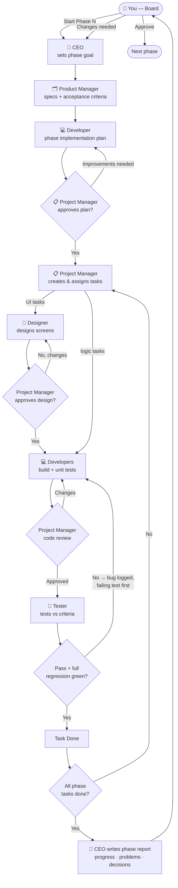
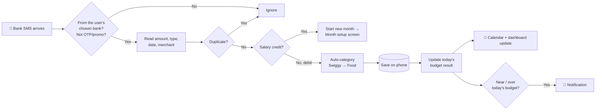
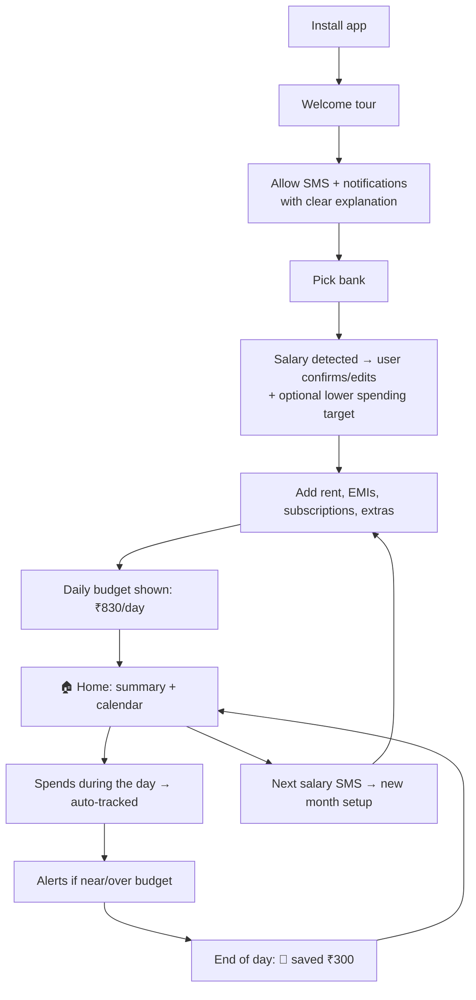

# Daily Budget App — Project Plan

> Working title. The final app name will be chosen after the app is built.

A minimalist Android app that reads your bank SMS alerts, splits your monthly salary into a **daily budget**, and shows every rupee you spend on a **calendar** — so you always know whether today you are under budget (saved) or over budget (overspent).

**Status:** 🟢 Phase 0 — Setup & team: signed off by the Project Manager; CEO report ready (`docs/reports/phase-0-report.md`); waiting for Owner approval.

---

## Table of contents

1. [Decisions so far](#1-decisions-so-far)
2. [How the app works](#2-how-the-app-works)
3. [Features](#3-features)
4. [Screens](#4-screens)
5. [Design direction](#5-design-direction)
6. [Technical architecture](#6-technical-architecture)
7. [Supported banks](#7-supported-banks)
8. [The agent team](#8-the-agent-team)
9. [How the team works automatically](#9-how-the-team-works-automatically)
10. [Flowcharts](#10-flowcharts)
11. [Development phases](#11-development-phases)
12. [Phase tracker](#12-phase-tracker)
13. [Laptop setup guide](#13-laptop-setup-guide)
14. [Risks and Play Store requirements](#14-risks-and-play-store-requirements)
15. [Future: iOS and beyond](#15-future-ios-and-beyond)

---

## 1. Decisions so far

| Topic | Decision |
|---|---|
| Audience | Public app, listed on Google Play Store |
| Platform | Android first. iOS later (see [section 15](#15-future-ios-and-beyond)) |
| Technology | Flutter (one codebase for Android now, iOS later) |
| Bank data | Read bank SMS alerts on the phone |
| Accounts | One bank account only. Credit cards not included. Shown as a disclaimer |
| Budget month | Starts on the user's own salary date (1st, 2nd, 5th, 25th… whatever it is) |
| Salary | Detected from the salary-credit SMS, and the user can edit it |
| Spending target | User can choose to budget less than the salary (e.g. salary ₹40,000, spend only ₹20,000) |
| Fixed costs | Asked at the start of every month: rent, EMIs, subscriptions, any extra items |
| Saved money | **Not** auto-carried to the next day. Shown as "saved". The user decides whether to use it to cover an overspent day |
| Categories | Detected automatically from the merchant (Swiggy/Zomato → Food, Zepto/Blinkit/Instamart → Groceries…) and editable |
| Notifications | Near/over-budget warnings + an end-of-day summary |
| Data storage | On the phone only. No login, no cloud |
| Themes | Light, Dark, Dim (soft middle theme) + Auto (follows phone) |
| Testing | Android emulator first, then the owner's real Android phone |
| Agent setup | Option B — agent team runs inside Claude Code |

---

## 2. How the app works

### The budget month
The budget month runs **from one salary date to the day before the next salary date.**
Example: salary arrives on the 5th → budget month is 5 Oct – 4 Nov (31 days).

### The daily budget formula

```
Spendable money  = Monthly target − Fixed costs
Daily budget     = Spendable money ÷ Days in the budget month
```

- **Monthly target** = the salary (detected from SMS) **or** a smaller amount the user chooses to spend.
- **Fixed costs** = rent + EMIs + subscriptions + any extras the user adds during month setup.

**Example 1: no fixed costs**
Salary ₹40,000, 30-day month → ₹40,000 ÷ 30 = **₹1,333 per day**

**Example 2: with fixed costs**
Salary ₹40,000 − Rent ₹10,000 − EMI ₹5,000 − Subscription ₹100 = ₹24,900
₹24,900 ÷ 30 = **₹830 per day**

**Example 3: the user saves half**
Salary ₹40,000, but the user sets the target to ₹20,000 → ₹20,000 ÷ 30 = **₹666 per day**

### Each day

```
Day result = Daily budget − Money spent that day
```

| Daily budget | Spent | Result | Shown as |
|---|---|---|---|
| ₹1,333 | ₹1,000 | +₹333 | 🟢 Saved ₹333 |
| ₹1,333 | ₹1,333 | ₹0 | ⚪ On budget |
| ₹1,333 | ₹1,800 | −₹467 | 🔴 Overspent ₹467 |

### Saved money (the "savings pot")
- Every saved amount goes into a **savings pot** for the month.
- Saved money is **not** added to tomorrow's budget automatically.
- If the user overspends on a day, they can tap **"Cover with savings"** to move money from the pot to that day. It's the user's choice.

### Top summary (always visible)
`Salary ₹40,000 · Fixed ₹15,100 · Spent so far ₹8,200 · Saved this month ₹1,150 · Overspent ₹300 · Left ₹16,700`

---

## 3. Features

### 3.1 First-time setup (onboarding)
- Short welcome tour explaining the idea in 3–4 screens.
- Asks for SMS permission, with a clear explanation of **why** and that **data never leaves the phone**.
- Asks the user to pick their bank (one account).
- Asks for salary date and amount (or detects it from existing SMS).
- Asks for notification permission (optional).
- Disclaimer: one bank account only, credit cards not tracked, auto-detection may need manual correction.

### 3.2 Month setup (every salary date)
- Shows the detected salary. User can edit it or set a smaller spending target.
- Fixed costs list: Rent, EMIs, Subscriptions, plus **"+ Add item"** for anything extra.
- Last month's fixed costs are pre-filled so the user just confirms.
- Shows the calculated daily budget before confirming.

### 3.3 Automatic transaction tracking
- Reads new bank SMS in the background and also imports past SMS for the current month.
- Extracts: amount, debit/credit, date, merchant / UPI receiver, balance (if present).
- Ignores OTPs, promotions, and messages from other banks.
- Detects duplicates (same transaction alerted twice).
- Manual add / edit / delete for anything missed.

### 3.4 Automatic categories
| Category | Example merchants |
|---|---|
| Food | Swiggy, Zomato, restaurants, cafés |
| Groceries | Zepto, Blinkit, Swiggy Instamart, BigBasket, DMart, JioMart |
| Shopping | Amazon, Flipkart, Myntra, Ajio, Meesho, Nykaa |
| Travel | Uber, Ola, Rapido, IRCTC, metro, fuel |
| Bills & Recharge | Electricity, Airtel, Jio, Vi, DTH, broadband |
| Entertainment | Netflix, Prime, Hotstar, Spotify, BookMyShow |
| Health | Pharmacies, hospitals, PharmEasy, 1mg |
| Friends & People | UPI payments to a person's name / phone |
| Other | Anything not matched |

- If the user changes a category, the app **remembers** it for that merchant next time.

### 3.5 Calendar
- Month view from salary date to salary date.
- Each day shows: spent amount and a color (green saved / grey on budget / red overspent).
- Tap a day → list of that day's transactions, budget, result, and "Cover with savings" button.

### 3.6 Dashboard
- Top summary (see section 2).
- Spending by category (month and selected day).
- Highest spending day, average daily spend, days saved vs overspent.

### 3.7 Notifications (if allowed)
- ⚠️ "You've used 80% of today's budget."
- 🔴 "You're ₹200 over today's budget."
- 🎉 End of day: "Congratulations! You saved ₹300 today."
- 📈 End of day: "Today was your highest spend this month (₹2,100)."
- Each notification type can be turned on/off in Settings.

### 3.8 Help everywhere
- Every button and setting has a short description underneath or a **(i)** tooltip.
- First-time hints on each main screen ("Tap a day to see details").
- Settings → "How this app works" page.

---

## 4. Screens

1. Welcome tour (3–4 slides)
2. Permissions (SMS, notifications), each with an explanation
3. Bank selection
4. Month setup (salary, target, fixed costs, daily budget preview)
5. **Home**: top summary + today's card + calendar
6. Day details
7. Dashboard / insights
8. Transactions list (search, filter, edit category)
9. Add / edit transaction
10. Settings (theme, notifications, bank, salary date, categories, privacy, help, disclaimer)

---

## 5. Design direction

- **Minimal, calm, modern.** Aimed at Gen Z and millennials. Must **not** look like a generic template or AI-generated UI.
- One strong accent color, lots of white space, large readable numbers, soft rounded shapes.
- Custom typography (not the default Roboto look), custom icons and illustrations where it matters.
- Meaningful color only: green = saved, red = overspent, neutral for everything else.
- Small, smooth animations (numbers counting, calendar transitions), never flashy.
- **Four theme options:**
  - **Light**: bright, clean
  - **Dark**: true dark for night use
  - **Dim**: soft middle theme (warm grey), easy on the eyes
  - **Auto**: follows the phone's setting
- Every control has a label + description or tooltip, so a first-time user is never confused.
- Accessibility: readable font sizes, enough color contrast, works with large system fonts.

The **Designer** agent creates the full design system (colors, fonts, spacing, components) in Phase 1. Every design is **previewed for the owner in the chat** as it's made (ASCII screen mockups + color palette), without stopping for approval. The owner gives feedback whenever they like, usually at the end of the phase.

---

## 6. Technical architecture

```
Sources ──► Parser ──► Categorizer ──► Local database ──► Budget engine ──► UI + Notifications
```

| Layer | What it does | Tools (decided in Phase 0) |
|---|---|---|
| Transaction sources | Android SMS now; later iOS Shortcuts, Account Aggregator, statement upload. Each is a separate "source" so new ones can be added without rewriting the app | Android SMS plugin or a small custom Kotlin module |
| Bank SMS parser | One template set per bank + a general fallback for unknown formats | Pure Dart, heavily unit-tested |
| Categorizer | Merchant → category rules + remembers user corrections | Pure Dart |
| Local database | Stores transactions, months, fixed costs, settings — **on the phone only** | SQLite (e.g. Drift), optionally encrypted |
| Budget engine | Daily budget, day results, savings pot, summaries | Pure Dart, heavily unit-tested |
| State management | Connects data to screens | Riverpod |
| Background work | Listen for SMS, end-of-day summary | Android background receiver + WorkManager |
| Notifications | Local notifications only | flutter_local_notifications |

**Privacy:** no server, no login, no analytics that send transaction data. All money data stays on the device.

Planned folder layout:

```
daily-budget-app/
├── README.md              ← this plan
├── CLAUDE.md              ← orchestrator rules (how Claude runs the team)
├── .claude/agents/        ← the agent team: ceo, product-manager, designer,
│                            project-manager, developer, tester
├── docs/
│   ├── features/          ← ONE DOC PER FEATURE: what it is, acceptance criteria,
│   │                        edge cases, help text (Product Manager) + INDEX.md
│   ├── WORKFLOW.md        ← team workflow, quality gates, bug lifecycle
│   ├── STANDARDS.md       ← engineering + design standards
│   ├── TASKS.md           ← task board (Project Manager)
│   ├── BUGS.md            ← bug list (Tester)
│   ├── DECISIONS.md       ← decisions made + who approved
│   ├── reviews/           ← design + code reviews (Project Manager)
│   ├── design/            ← design system + screen specs (Designer)
│   └── reports/           ← CEO phase reports for the owner
├── plans/                 ← ONE PLAN PER FEATURE: how it will be built
│                            (Developer, approved by Project Manager)
│                            + phase overviews (CEO)
├── tests/                 ← ONE TEST FILE PER FEATURE: test cases incl. edge cases,
│                            run results, test report to PM (Tester)
│                            + REGRESSION.md
└── app/                   ← the Flutter project (created in Phase 0)
    └── test/              ← the automated tests (named by test case ID)
```

### The three files for every feature
Each feature (e.g. `F-002-month-setup`) has a file with the **same name** in each of the three folders:

| File | Written by | Answers | Checked by |
|---|---|---|---|
| `docs/features/F-002-month-setup.md` | Product Manager | **What** is it? Acceptance criteria, edge cases, help text | Project Manager |
| `plans/F-002-month-setup.md` | Developer | **How** will we build it? Tasks, risks, impact on other features | Project Manager (approves before coding) |
| `tests/F-002-month-setup.md` | Tester (before coding) | **How** do we prove it works? Test cases, results, test report | Project Manager |

The files link together: every acceptance criterion → a task in the plan → test cases → an automated test named with the test case ID → a recorded result. The Project Manager uses this chain to make sure nothing is missed.

---

## 7. Supported banks

Phase 4 targets the major Indian banks first, then expands. A **generic parser** handles unknown banks as a fallback.

**Wave 1 (largest banks):** SBI, HDFC Bank, ICICI Bank, Axis Bank, Kotak Mahindra Bank, HSBC, IDBI Bank

**Wave 2 (other major banks):** Punjab National Bank, Bank of Baroda, Canara Bank, Union Bank of India, Bank of India, Indian Bank, Central Bank of India, IndusInd Bank, Yes Bank, IDFC FIRST Bank, Federal Bank, RBL Bank, AU Small Finance Bank, Bandhan Bank, Indian Overseas Bank, UCO Bank, Bank of Maharashtra, Punjab & Sind Bank, South Indian Bank, Karnataka Bank, Standard Chartered

**Wave 3:** remaining scheduled banks, small finance banks and payments banks (Airtel, Paytm, India Post).

> UPI apps (GPay, PhonePe, Paytm) don't send their own SMS — the **bank** sends the debit SMS, so UPI payments are covered through the bank's message.

Each bank's SMS formats are collected as sample messages (with personal details removed) and turned into tests, so the Tester can check every format.

---

## 8. The agent team

Seven roles, each defined as a Claude Code agent in `.claude/agents/`. You (the owner) sit above all of them as the **Board**.

| Role | Responsibility | Writes / owns | Reports to |
|---|---|---|---|
| 👤 **You (Board)** | Final say on big decisions: plan, design system, phase sign-off, anything touching money, privacy or Play Store | — | — |
| 🧭 **CEO** | Keeps the vision. Plans each phase's goals. Writes a plain-language report after every phase: what's done, progress, problems, decisions needed. Escalates big decisions to you | `docs/reports/`, `docs/DECISIONS.md` | You |
| 🗂️ **Product Manager (Organizer)** | Writes the **feature doc** for each feature: what it is, how it behaves, **acceptance criteria** ("done means…"), edge cases, help text | `docs/features/` | CEO |
| 🎨 **Designer** | Design system, the 4 themes, screen layouts, tooltip/help text, onboarding copy | `docs/design/` | Project Manager (approval) |
| 📋 **Project Manager (Task Distributor + senior reviewer)** | The most senior engineer and UX reviewer. **Cross-checks each feature's doc, plan and test cases before coding**, and approves every design, piece of code and test report. In every review, pushes for better UX, cleaner code (removing dead/duplicate code) and modern Flutter/Dart features. Creates and assigns tasks, tracks status, signs off phases | `docs/TASKS.md`, `docs/reviews/`, review sections in `plans/` | CEO |
| 💻 **Developers** | **Write the feature plan first**, then build tasks in Flutter with automated tests named by test case ID. Fix bugs by writing a failing test first, then the fix. Complete the technical section of the feature doc at the end | `plans/`, `app/` | Project Manager |
| 🧪 **Tester (QA)** | **Writes the test cases before coding**, runs them, records results and sends a test report to the Project Manager. Logs bugs, and after **every** fix re-runs the **full** test suite + regression checklist so old code is tested again | `tests/`, `docs/BUGS.md`, test code | Project Manager |

Agent files live in `.claude/agents/`. Full details: [`docs/WORKFLOW.md`](docs/WORKFLOW.md) and [`docs/STANDARDS.md`](docs/STANDARDS.md).

### What reaches you vs. what doesn't

**Comes to you (big decisions):**
- Approving the plan, the design system, and each finished phase
- Anything about privacy, permissions, money calculations, or Play Store policy
- Adding a paid service or changing scope
- Disagreements the team couldn't resolve

**Handled by the team (no need to bother you):**
- Small design tweaks within the approved design system
- Task order, code structure, bug fixes
- Choosing between equivalent libraries

---

## 9. How the team works automatically

When you say **"Start Phase N"**, Claude (the orchestrator) runs the team in this loop:

1. **CEO** writes the phase overview (`plans/phase-N-overview.md`): goal and list of features.
2. For each feature, **Product Manager** writes the feature doc (`docs/features/F-xxx.md`).
3. **Developer** writes the feature plan (`plans/F-xxx.md`): approach, files, packages (latest stable), tasks, risks, impact on existing features.
4. At the same time, **Tester** writes the test cases (`tests/F-xxx.md`) for every acceptance criterion and edge case, **before any code exists**.
5. 🚦 **Gate 1:** **Project Manager** cross-checks all three files together and suggests improvements (UX, simpler code, newer features, missing edge cases). Nothing is coded until it is approved. Big decisions come to you.
6. **Project Manager** creates the tasks (`T-401`, `T-402`…) in `docs/TASKS.md` and assigns them.
7. **Designer** designs any UI tasks → 🚦 **Gate 2:** Project Manager design review.
8. **Developer** builds each task so the written test cases will pass, with automated tests named by test case ID → 🚦 **Gate 3:** Project Manager code review.
9. **Tester** runs every test case from `tests/F-xxx.md`, records the results in that file, and sends a **test report to the Project Manager** → 🚦 **Gate 4:**
   - ✅ Pass (and full test suite green) → Developer completes the technical section of the feature doc → feature "Done".
   - ❌ Fail → bug logged in `docs/BUGS.md` + a permanent regression case in the test file → Developer writes a **failing test first**, then fixes → code review → Tester re-tests **and re-runs the full test suite + regression checklist**.
10. 🚦 **Gate 5:** **Project Manager** signs off the phase after a final full regression.
11. **CEO** writes the phase report in `docs/reports/phase-N-report.md` from these files and brings you only the decisions that need you.
12. 🚦 **Gate 6:** **You** approve → the next phase can start.

**Task statuses:** `To do → In design → Design review → In progress → Code review → Ready for test → Bug found → Done`

**Honest note on "automatic":** with Option B, the team works while a Claude Code session is running. You start a phase with one message, and the agents run the whole loop, but it doesn't run 24/7 on its own. If you later want round-the-clock agents with a dashboard, the same roles can move to Paperclip.

---

## 10. Flowcharts

### 10.1 How the agent team works



### 10.2 How the app handles a transaction



### 10.3 The user's journey



---

## 11. Development phases

Each phase goes through the full agent loop in [section 9](#9-how-the-team-works-automatically) and ends with a CEO report and your approval.

### Phase 0 — Setup & team
- [ ] Laptop setup completed (see [section 13](#13-laptop-setup-guide))
- [ ] Flutter project created in `app/`, runs on the emulator
- [x] Agent team created in `.claude/agents/`
- [x] `CLAUDE.md`, `docs/WORKFLOW.md`, `STANDARDS.md`, `TASKS.md`, `BUGS.md`, `DECISIONS.md`, report template created
- [x] `docs/features/`, `plans/`, `tests/` folders with templates, feature index and regression checklist
- [ ] Git repository initialised (so every change can be reviewed and undone)
- [ ] Strict lint rules + test setup in the Flutter project
- [ ] Final library choices recorded in `DECISIONS.md`

**You approve:** project runs on the emulator; agent team ready.

### Phase 1 — Design system & app shell
- [ ] Design system: colors, fonts, spacing, components
- [ ] 4 themes: Light, Dark, Dim, Auto
- [ ] Navigation shell (Home, Dashboard, Transactions, Settings)
- [ ] Tooltip/help component used everywhere
- [ ] Welcome tour + permission screens (UI only)

**You approve:** the look and feel of the app.

### Phase 2 — Budget engine & month setup
- [ ] Local database
- [ ] Budget month from salary date to salary date
- [ ] Month setup: salary, optional target, fixed costs (+ add item), daily budget preview
- [ ] Budget engine: daily budget, day result, savings pot, "cover with savings"
- [ ] Manual add/edit/delete transactions
- [ ] Unit tests for every calculation (including 28/29/30/31-day months, mid-month start)

**You approve:** calculations are correct using manual entries.

### Phase 3 — Calendar & dashboard
- [ ] Home screen: top summary + today's card
- [ ] Calendar with green/grey/red days
- [ ] Day details + "Cover with savings"
- [ ] Dashboard: by category, highest day, averages
- [ ] Transactions list with search/filter

**You approve:** the app is fully usable with manual entries.

### Phase 4 — SMS reading & auto-categories
- [ ] SMS permission flow with clear explanation
- [ ] Read past SMS for the current month + listen for new ones
- [ ] Parsers for Wave 1 banks (SBI, HDFC, ICICI, Axis, Kotak, HSBC, IDBI) + generic fallback
- [ ] Salary SMS detection → starts new month
- [ ] Duplicate detection; ignore OTP/promo
- [ ] Auto-categorizer + "remember my correction"
- [ ] Parsers for Wave 2 banks
- [ ] Tested on emulator with sample bank messages

**You approve:** transactions appear automatically and correctly.

### Phase 5 — Notifications
- [ ] Near-budget (80%) and over-budget alerts
- [ ] End-of-day summary (saved / overspent / highest day)
- [ ] On/off switch for each notification type
- [ ] Works when the app is closed

**You approve:** notifications feel helpful, not annoying.

### Phase 6 — Polish & real-phone testing
- [ ] First-time hints on every main screen, "How this app works" page
- [ ] Animations and empty states
- [ ] Accessibility (large fonts, contrast)
- [ ] Test on your real Android phone with your real bank SMS
- [ ] Battery/background checks (Xiaomi, Samsung, Oppo, Vivo, OnePlus kill background apps differently)
- [ ] Full regression test by the Tester

**You approve:** ready for release preparation.

### Phase 7 — Play Store readiness
- [ ] Privacy policy (data stays on device) + in-app disclaimer
- [ ] Google Play **SMS permission declaration** (SMS-based money management)
- [ ] Data safety form, DPDP Act compliance check
- [ ] App name, icon, screenshots, store listing text
- [ ] Signed release build
- [ ] Internal testing track → closed testing → production

**You approve:** submission to Google Play.

---

## 12. Phase tracker

Updated by the Project Manager and CEO as work moves forward.

| Phase | Plan approved | Design | Development | Testing | PM sign-off | CEO report | Your approval |
|---|---|---|---|---|---|---|---|
| 0 — Setup & team | ✅ | — | ✅ | ✅ | ✅ | ✅ | ⬜ |
| 1 — Design system & shell | ⬜ | ⬜ | ⬜ | ⬜ | ⬜ | ⬜ | ⬜ |
| 2 — Budget engine & month setup | ⬜ | ⬜ | ⬜ | ⬜ | ⬜ | ⬜ | ⬜ |
| 3 — Calendar & dashboard | ⬜ | ⬜ | ⬜ | ⬜ | ⬜ | ⬜ | ⬜ |
| 4 — SMS reading & categories | ⬜ | ⬜ | ⬜ | ⬜ | ⬜ | ⬜ | ⬜ |
| 5 — Notifications | ⬜ | ⬜ | ⬜ | ⬜ | ⬜ | ⬜ | ⬜ |
| 6 — Polish & real-phone testing | ⬜ | ⬜ | ⬜ | ⬜ | ⬜ | ⬜ | ⬜ |
| 7 — Play Store readiness | ⬜ | ⬜ | ⬜ | ⬜ | ⬜ | ⬜ | ⬜ |

Legend: ⬜ Not started · 🟡 In progress · ✅ Done · ❌ Blocked

---

## 13. Laptop setup guide

Your laptop currently has **Git** installed. Still needed: **Flutter SDK**, **Android Studio** (includes Java, Android SDK and the emulator), and optionally **VS Code**.
You have plenty of disk space (~234 GB free) and enough RAM (~14 GB) for the emulator.

### Step 1 — Android Studio
1. Download from **developer.android.com/studio** and install with default options.
2. Open it and finish the setup wizard (it downloads the Android SDK, ~5–8 GB).
3. In Android Studio: **More Actions → SDK Manager → SDK Tools** tab → tick **Android SDK Command-line Tools** → Apply.
4. Same **SDK Tools** tab → tick **Show Package Details** (bottom right) → under **NDK (Side by side)** tick **30.0.16248370** → Apply (~1 GB).
   Why: Flutter's default NDK could not be installed automatically on this setup, so the app is pinned to this version (`docs/DECISIONS.md` D-025). Without it the first build fails.
5. **More Actions → Virtual Device Manager → Create device** → pick a phone (e.g. Pixel 7) → download a recent system image → Finish. This is the emulator the app runs on.
6. Install the **Flutter** plugin: **Plugins → Marketplace → "Flutter"** → Install (it also installs Dart).

### Step 2 — Flutter SDK
1. Download the Windows Flutter SDK zip from **docs.flutter.dev/get-started/install/windows/mobile**.
2. Extract it to `C:\src\flutter` (**not** inside `Program Files` and **not** in a folder with spaces).
3. Add `C:\src\flutter\bin` to your user **PATH**:
   Start → search "Edit environment variables for your account" → **Path** → **Edit** → **New** → `C:\src\flutter\bin` → OK.
4. Open a **new** terminal and check:

```bash
flutter --version
```

### Step 3 — Accept licenses and check everything

```bash
flutter doctor --android-licenses
```

```bash
flutter doctor
```

All Android items should show ✅. (Items about Visual Studio / Windows desktop / Chrome can be ignored — we only build for Android.)

### Step 4 — Windows Developer Mode
Flutter plugins need symlink support: **Settings → System → For developers → Developer Mode → On**.

### Step 5 (optional) — VS Code
Install from **code.visualstudio.com**, then add the **Flutter** extension.

Once `flutter doctor` is clean, tell Claude **"Setup done"** and Phase 0 continues.

> Note: the project folder path (`Idea bank`) contains a space. Modern Flutter handles this, but if a build tool complains, we'll move the project to a path without spaces.

---

## 14. Risks and Play Store requirements

| Risk | Impact | Plan |
|---|---|---|
| Google Play restricts SMS permission | App could be rejected | Submit the "SMS-based money management" declaration; explain the core feature clearly; keep manual entry as a fallback |
| Bank SMS formats differ and change | Missed or wrong transactions | Per-bank templates + generic fallback + many sample tests; easy manual correction |
| Phone makers kill background apps | SMS missed while app closed | Re-scan the SMS inbox when the app opens; guide users to disable battery optimization |
| Data privacy (India DPDP Act 2023) | Legal requirement for a public app | Data stays on device, clear privacy policy, user can delete all data anytime |
| Wrong category detection | Confusing dashboard | User can correct; app remembers corrections |
| Not financial advice | Legal | Disclaimer in app and store listing |

---

## 15. Future: iOS and beyond

iOS does **not** allow any app to read SMS. Options for the iOS version:

1. **iOS Shortcuts automation** — a one-time guided setup: "When a message from my bank arrives → send it to the app." The same parser then handles it.
2. **Account Aggregator** (RBI's official framework, via a licensed partner like Setu or Finvu) — works on Android and iOS without SMS; involves partner costs and paperwork.
3. **Statement upload** (PDF/CSV) and manual entry.

Because transaction sources are kept separate in the architecture, adding these later won't need a rewrite.

Other ideas for later: multiple bank accounts, credit cards, savings goals, export to Excel/PDF, home-screen widget.
