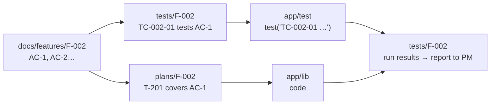
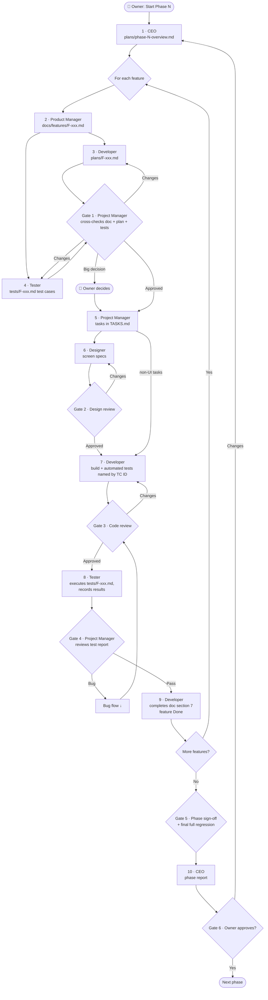
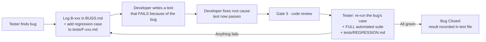

# Team Workflow

How the agent team turns a phase from the README into working, tested features — and how only big decisions reach the Owner.

## Roles in one line

- 👤 **Owner (you)** — approves big decisions and each finished phase.
- 🧭 **CEO** — sets phase goals, reports to the Owner, escalates.
- 🗂️ **Product Manager** — writes the feature doc: what it is, acceptance criteria, edge cases.
- 🎨 **Designer** — designs screens, themes and help text.
- 📋 **Project Manager** — the senior reviewer: cross-checks doc + plan + tests, approves designs and code; assigns tasks; pushes for better UX, cleaner code and modern features.
- 💻 **Developer** — writes the feature plan, builds, fixes bugs.
- 🧪 **Tester** — writes the test cases before coding, executes them, reports to the Project Manager, runs full regression after every fix.

## The three files for every feature

Every feature gets **one file with the same name in each of three folders**, e.g. `F-002-month-setup.md`:

| Folder | Written by | Answers | Used by |
|---|---|---|---|
| `docs/features/` | Product Manager (Developer adds the technical section at the end) | **What** is it, how should it behave, what are the acceptance criteria (AC) and edge cases? | Everyone — the single source of truth for the feature |
| `plans/` | Developer | **How** will we build it: approach, files, tasks, risks, which AC each task covers | Project Manager (review), Developer (build), Tester (what to test, impact on other features) |
| `tests/` | Tester | **How** do we prove it works: test cases for every AC + edge cases, results of each run, test report | Developer (build to pass them), Project Manager (Gate 4), everyone (regression) |

### How the three files connect (traceability)

- Every **AC** in the doc → covered by a **task** in the plan → proved by at least one **test case** in the test file.
- Every automated test is named with its **TC ID**, so a failing test points straight to the case, the AC and the feature.
- The Project Manager uses this chain to check nothing is missed: no AC without a task, no AC without a test case, no test case without a result.

### Why this helps
- **Before coding:** the plan and test cases are written and cross-checked together, so gaps are found on paper, not in the app.
- **During coding:** the Developer builds to pass the test cases already written (test-first thinking).
- **During testing:** the Tester tests from the files, not from memory, and records every result in the test file.
- **Later features:** each plan has an "Impact on existing features" section; the listed features' test cases are re-run. New team members (or a new Claude session) read `docs/features/` to understand the app without reading code.
- **Bugs:** every bug adds a permanent regression case to the feature's test file.
- **Reports:** the CEO builds the Owner report from these files, so it is always accurate.

## The phase loop

### Step by step

| Step | Who | Writes | Reads |
|---|---|---|---|
| 1 | CEO | `plans/phase-N-overview.md` (from `plans/_PHASE_TEMPLATE.md`): goal, scope, feature list | README, last report |
| 2 | Product Manager | `docs/features/F-xxx-name.md` (from template); adds the row to `docs/features/INDEX.md` | Phase overview, README |
| 3 | Developer | `plans/F-xxx-name.md` (from `plans/_TEMPLATE.md`) | Feature doc, `STANDARDS.md`, existing code and docs |
| 4 | Tester | `tests/F-xxx-name.md` (from `tests/_TEMPLATE.md`): test cases for every AC and edge case | Feature doc, plan |
| Gate 1 | Project Manager | Review section in the plan | All three files together |
| 5 | Project Manager | Tasks in `docs/TASKS.md` | Approved plan |
| 6 | Designer | `docs/design/screens/…` | Feature doc, design system |
| Gate 2 | Project Manager | `docs/reviews/design-<task>.md` | Screen specs |
| 7 | Developer | Code in `app/lib`, automated tests in `app/test` named by TC ID; plan section 11 | Plan, test cases, design |
| Gate 3 | Project Manager | `docs/reviews/code-<task>.md` | Changed code, plan |
| 8 | Tester | Results + test report in `tests/F-xxx-name.md`; bugs in `docs/BUGS.md` | Test file, app, full suite |
| Gate 4 | Project Manager | Verdict on the test report | Test file |
| 9 | Developer | Section 7 of the feature doc; INDEX status → Done | — |
| Gate 5 | Project Manager | Sign-off in phase overview | All feature files, final regression |
| 10 | CEO | `docs/reports/phase-N-report.md` | Everything above |
| Gate 6 | **Owner** | Approve or request changes | Report |

## Quality gates

| Gate | Decided by | Passes when |
|---|---|---|
| 1 · Plan + tests | Project Manager | Every AC has a task and a test case; edge cases appear in plan and tests; approach follows `STANDARDS.md` and uses the best current tools |
| 2 · Design | Project Manager | All 4 themes, help text on every control, all states defined, accessible. The Owner sees a preview of every design in the chat but is not asked to approve it; their feedback comes when they choose, usually at phase end |
| 3 · Code | Project Manager | Matches plan, clean, no dead code, tests named by TC ID, analyzer clean, modern idioms |
| 4 · Test report | Project Manager | Every test case run and passed, every AC covered, full regression green |
| 5 · Phase | Project Manager | All features Done (three files complete), no open High/Critical bugs, final regression green |
| 6 · Owner | Owner | Owner approves the CEO report |

## What the Project Manager looks for in every review

Not just "does it work", but "is this the best version of it":

1. **UX/UI improvements** — fewer taps, clearer wording, better defaults, better empty states and feedback.
2. **Code improvements** — simpler logic, remove dead or duplicated code, better names, smaller widgets, clearer layers.
3. **Modern features** — newer Dart/Flutter/library features that make the code safer or the app better.
4. **Bug prevention** — missing edge cases or test cases, money rounding, month lengths, empty data, permissions.
5. **Performance, accessibility, privacy and security.**

Every point is labelled **Must fix** (blocks approval) or **Nice to have** (becomes a follow-up task).

## Bug lifecycle and regression

- Every fixed bug leaves a permanent regression case in the feature's test file and a permanent automated test.
- After every fix, the **whole** suite runs, so previously tested code is checked again.

## Escalate to Owner (big decisions)

- Approving each phase report (design is **shown**, not escalated — see "Design previews" below)
- Any change to how money is calculated or displayed
- New permissions, privacy changes, anything that sends data off the phone
- Google Play policy questions
- Adding a paid service or a dependency with a cost
- Changing scope (adding/removing features from the README)
- A review rejected 3 times (deadlock)

Everything else the team decides and records in `docs/DECISIONS.md`.

## Design previews

- Every time the Designer creates or changes a design, the Owner sees a rough preview in the chat right away: ASCII screen mockups, the color palette and the main design choices.
- The team **does not wait** for the Owner's reply. The Project Manager approves designs (Gate 2) and work continues.
- The Owner can ask "how is this managed?" or give soft feedback ("this could be better") at any time, usually at phase end. That feedback becomes a change request: Designer updates → Project Manager reviews → normal flow.

## Statuses and IDs

- Feature: `Spec → In plan → Plan approved → In progress → Testing → Done`
- Task: `To do → In design → Design review → In progress → Code review → Ready for test → Bug found → Done`
- IDs: features `F-001`, tasks `T-201` (phase 2), test cases `TC-002-01` (feature 2, case 1), bugs `B-001`, decisions `D-001`
